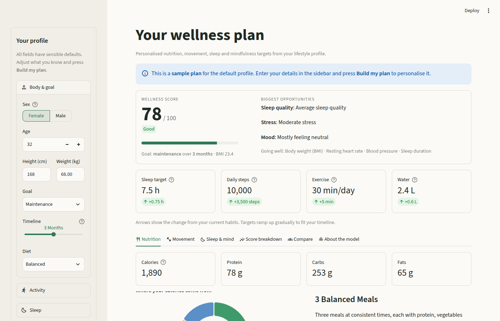
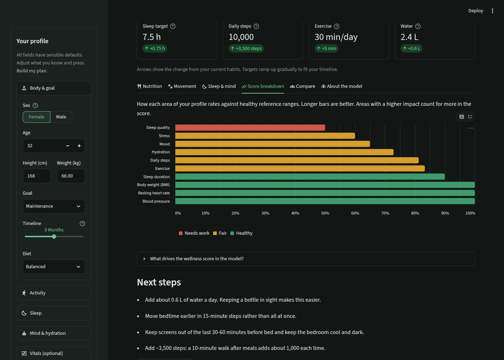

# Personal Wellness Recommender

[](https://github.com/GouravLuinor/PersonalWellnessRecommender/actions/workflows/ci.yml)

A machine learning–powered wellness app that turns a short lifestyle profile into a personalised plan covering nutrition, movement, sleep and mindfulness, and explains *why*.

> **Note:** This project uses synthetically generated data. It is an educational ML project, **not** a medical tool. See [Limitations](#limitations).



---

## Features

- **Personalised plan**: daily calories and macros, water, sleep target and bedtime, exercise minutes, step goal, a workout plan, a meal pattern and a mindfulness practice.
- **Wellness score (0-100)** with a per-area breakdown showing your biggest opportunities and what's already going well.
- **Progress, not perfection**: targets ramp up from your current habits according to your chosen timeline (1, 3 or 6 months).
- **Safety notes** for high blood pressure, high resting heart rate, very low BMI, and when to check with a doctor before exercising.
- **Compare** any metric against 10,000 simulated profiles.
- **Transparent models**: held-out accuracy and the features that drive the score are shown in the app.
- **Download** your plan as Markdown.
- Light and dark themes, plus a mobile-friendly layout.



---

## How it works

```text
 profile ──► rules (guidelines) ──► synthetic dataset (10k rows + noise) ──► ML models ──► plan
                                                                                    ▲
                                       your inputs ─────────────────────────────────┘
```

1. **Rules** (`app/wellness/rules.py`) encode simplified, evidence-informed guidance:
   - Mifflin-St Jeor basal metabolic rate × activity factor, adjusted for goal and timeline
   - Protein at 1.2-2.2 g/kg depending on goal, training and diet. Keto and standard macro splits
   - WHO guidance on physical activity (150-300 min/week) and adult sleep (7-9 h)
   - About 33 ml of water per kg of body weight, plus exercise losses
2. **Data** (`app/wellness/data.py`) simulates realistic, correlated profiles. For example, higher BMI goes with less activity, stress with shorter sleep, and age with higher blood pressure. Targets come from the rules plus individual variation and label noise.
3. **Models** (`app/wellness/model.py`) learn the mapping:
   - `HistGradientBoostingRegressor` (wrapped in `MultiOutputRegressor`) for the 9 numeric targets
   - `RandomForestClassifier` for workout plan, meal pattern and mindfulness practice
   - Preprocessing with `ColumnTransformer` (`StandardScaler` + `OneHotEncoder`)
   - Permutation importance for the wellness-score drivers

   Typical held-out results: R² 0.92-0.98 for most numeric targets (sleep target ≈ 0.7) and 92-95% classification accuracy, against 32-46% for always guessing the most common answer.
4. **Recommendations** (`app/wellness/recommend.py`) turn predictions into a plan with bedtime, focus areas, tips, alerts and an export.

Trained models are cached in `data/generated/` and rebuilt automatically when the data version or scikit-learn version changes.

---

## Project structure

```text
PersonalWellnessRecommender/
├── app/
│   ├── streamlit_app.py        # Streamlit UI
│   └── wellness/               # Core package (no Streamlit dependency)
│       ├── schema.py           # Feature/target definitions and options
│       ├── rules.py            # Guideline-based targets and wellness score
│       ├── data.py             # Synthetic dataset generation and caching
│       ├── model.py            # Training, evaluation, persistence, inference
│       └── recommend.py        # Plan building, tips, alerts, Markdown export
├── tests/                      # pytest suite (rules, data, models, plan, app)
├── .streamlit/config.toml      # Theme (light and dark)
├── .github/workflows/ci.yml    # Lint and test on every push / PR
├── data/generated/             # Created at runtime; ignored by Git
├── docs/                       # Report, data methodology, screenshots, legacy docs
├── notebooks/                  # Original exploratory notebook
├── requirements.txt            # Runtime dependencies
├── requirements-dev.txt        # + pytest, ruff, notebook libraries
└── pyproject.toml              # pytest and ruff configuration
```

---

## Getting started

Requires **Python 3.11+**.

```bash
git clone https://github.com/GouravLuinor/PersonalWellnessRecommender.git
cd PersonalWellnessRecommender

python3 -m venv .venv
source .venv/bin/activate          # Windows: .venv\Scripts\Activate.ps1

pip install -r requirements.txt
streamlit run app/streamlit_app.py
```

Open <http://localhost:8501>. The first launch generates the dataset and trains the models (about 20-30 seconds). After that, startup is instant.

You can also open the repo in **GitHub Codespaces** or a **VS Code Dev Container**. The app starts automatically.

### Development

```bash
pip install -r requirements-dev.txt
pytest            # 47 tests, ~1 minute
ruff check app tests
```

---

## Limitations

- The dataset is **synthetic**. The models learn the project's own rules, so high accuracy shows that the pipeline works, **not** that the recommendations are clinically valid.
- The rules are simplified population-level guidance and ignore medical conditions, medications, pregnancy, and other individual factors.
- The wellness score is a heuristic, not a validated clinical index.
- The notebook in `notebooks/` documents the original (v1) approach and uses the older data generator.

## Future improvements

- Validate against suitable real-world public datasets
- Per-prediction explanations (e.g. SHAP)
- Optional persistent profiles to track progress over time
- API-based inference separated from the UI

## Documentation

- `docs/project-report.pdf`: project report
- `docs/synthetic-data-methodology.pdf`: original synthetic data methodology
- `docs/legacy/`: documentation from the original repositories before consolidation

---

## Disclaimer

This software is an educational machine learning project. It does not provide medical advice, diagnosis or treatment. Always consult a qualified healthcare professional about decisions concerning your health.
