<div align="center">

# 🌿 Personal Wellness Recommender

**Turn a two-minute lifestyle profile into a personalised, explainable wellness plan.**

Nutrition · Movement · Sleep · Mindfulness, powered by machine learning and grounded in health guidelines.

[](https://github.com/GouravLuinor/PersonalWellnessRecommender/actions/workflows/ci.yml)


<br>

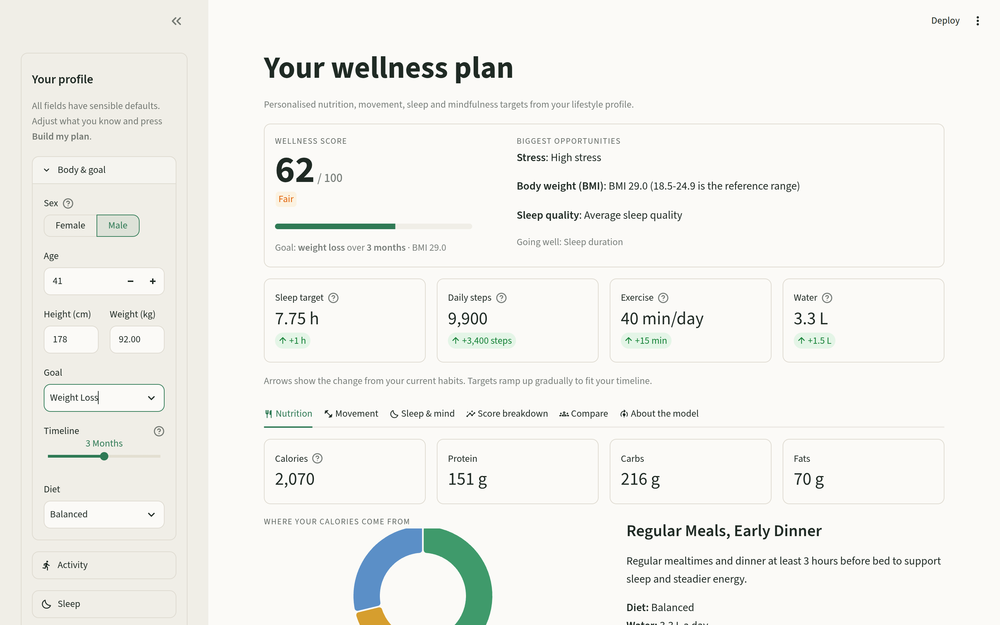

</div>

---

## ✨ Why it's different

Most "wellness recommenders" hand back generic advice. This one:

| | |
|---|---|
| 🎯 **Personal, not generic** | Every number is driven by *your* profile: body, goal, timeline, activity, sleep, stress and vitals. |
| 🪜 **Meets you where you are** | Targets ramp up from your current habits to fit your chosen 1, 3 or 6-month timeline. It never asks a sedentary person for 15,000 steps on day one. |
| 🔍 **Explains itself** | A 0-100 wellness score with a per-area breakdown, your biggest opportunities, and the features that drive the model. |
| 🩺 **Safety-aware** | Flags high blood pressure, a high resting heart rate and a very low BMI, and says when to check with a doctor first. |
| 📏 **Grounded in guidelines** | Mifflin-St Jeor energy needs, WHO activity and sleep guidance, and protein per kg of body weight. |
| 📊 **Honest about accuracy** | Held-out model metrics are shown in the app, next to a "guess the most common answer" baseline. |

---

## 📸 Tour

### Your plan at a glance
The summary card at the top (shown above) gives your **wellness score**, your **three biggest opportunities**, what's **going well**, and how each daily target compares with what you do today. Below it, six tabs go deeper.

### Six views of your plan

<table>
  <tr>
    <td width="50%" valign="top">
      <b>🍽️ Nutrition</b><br>
      Calories and macros, a calorie-source donut, a meal pattern with guidance, a water target and your estimated BMR.
      <br><br>
      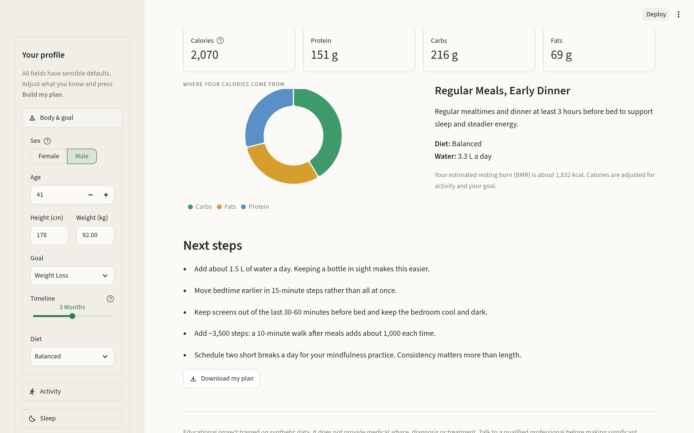
    </td>
    <td width="50%" valign="top">
      <b>🏃 Movement</b><br>
      A recommended workout plan with how-to guidance, and progress bars from today's exercise and steps to target.
      <br><br>
      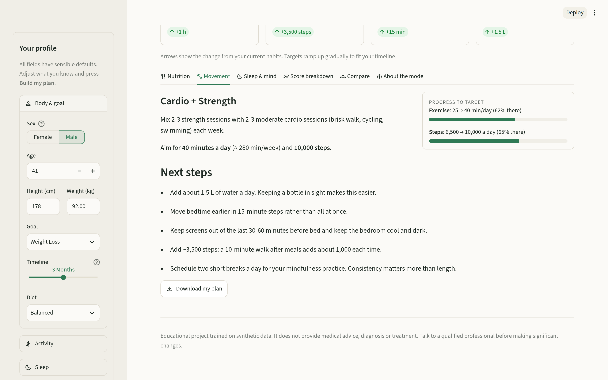
    </td>
  </tr>
  <tr>
    <td width="50%" valign="top">
      <b>🌙 Sleep &amp; mind</b><br>
      A sleep target, a "lights out by" bedtime worked back from your wake time, and a mindfulness practice chosen for your stress, sleep and mood.
      <br><br>
      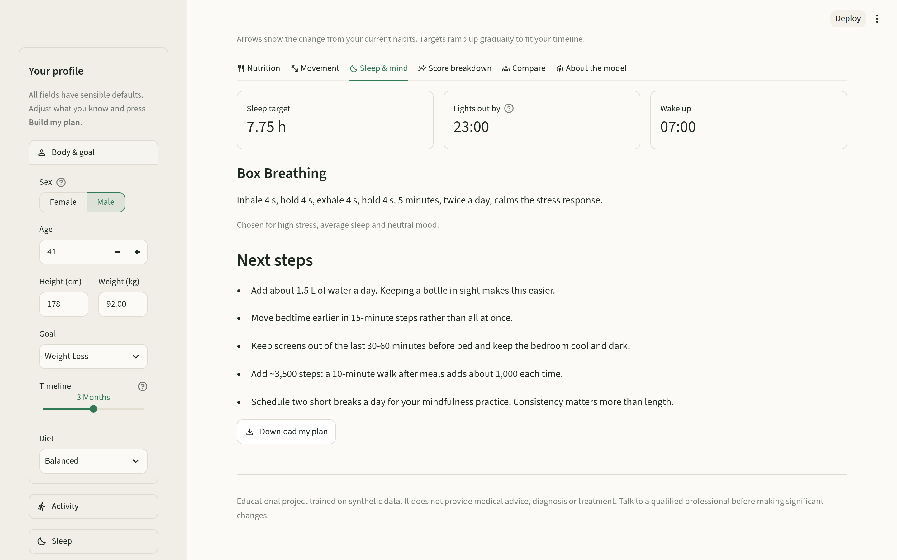
    </td>
    <td width="50%" valign="top">
      <b>📈 Score breakdown</b><br>
      Each of the 10 areas rated against healthy reference ranges, plus permutation importance showing what drives the model's score.
      <br><br>
      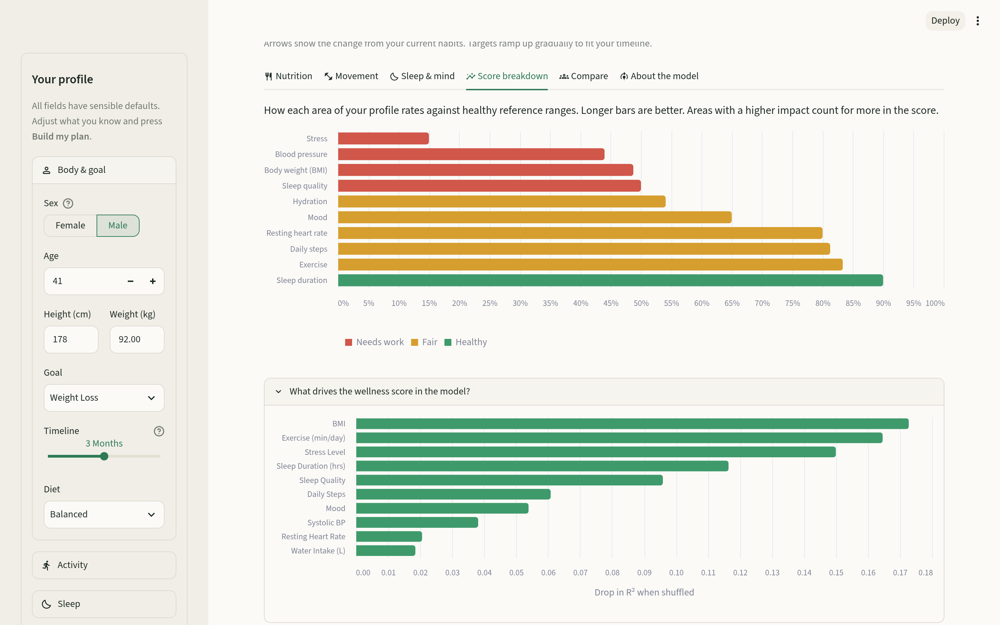
    </td>
  </tr>
  <tr>
    <td width="50%" valign="top">
      <b>👥 Compare</b><br>
      See where you sit among 10,000 simulated profiles for sleep, steps, exercise, BMI, heart rate, blood pressure, water or score.
      <br><br>
      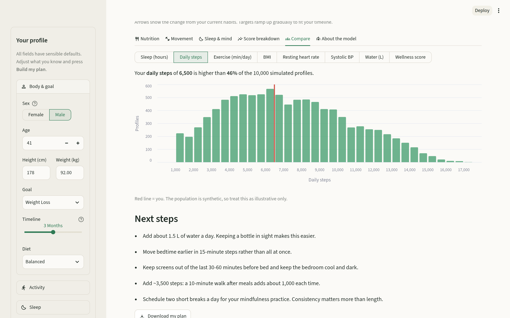
    </td>
    <td width="50%" valign="top">
      <b>🧠 About the model</b><br>
      Held-out R², mean absolute error and accuracy for every prediction, each shown against a naive baseline.
      <br><br>
      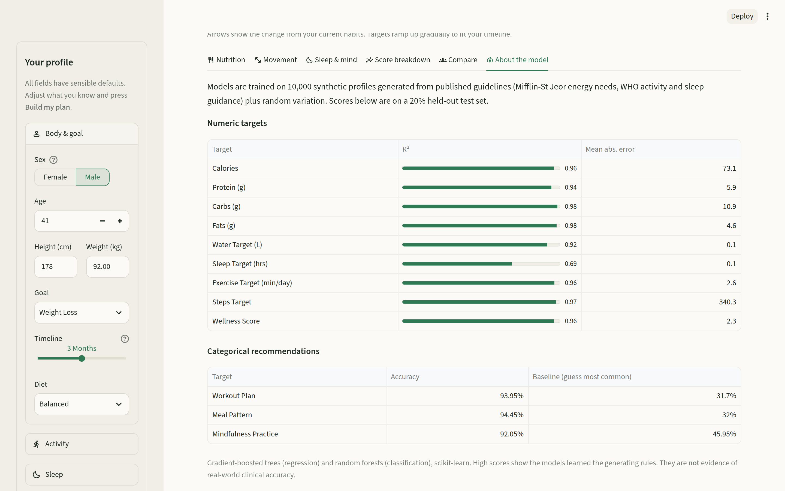
    </td>
  </tr>
</table>

### Dark mode, health alerts and mobile

<table>
  <tr>
    <td width="60%" valign="top">
      <b>🌗 Full dark theme with safety alerts</b><br>
      Follows your system theme. Readings such as high blood pressure trigger a clear, non-alarming prompt to see a professional.
      <br><br>
      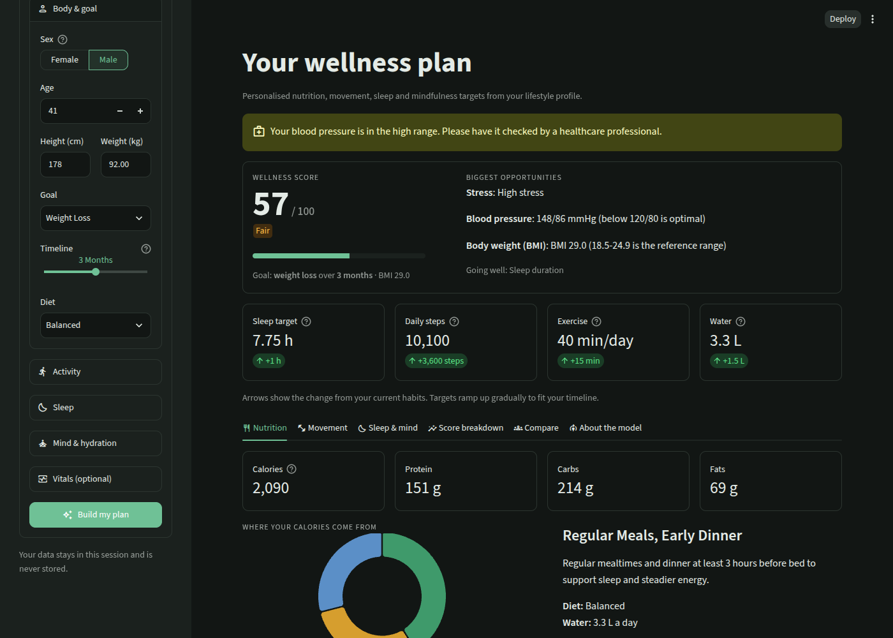
    </td>
    <td width="20%" valign="top">
      <b>📱 Mobile plan</b><br><br>
      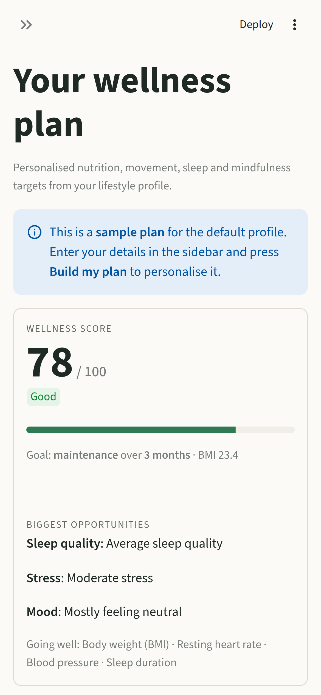
    </td>
    <td width="20%" valign="top">
      <b>📝 Mobile form</b><br><br>
      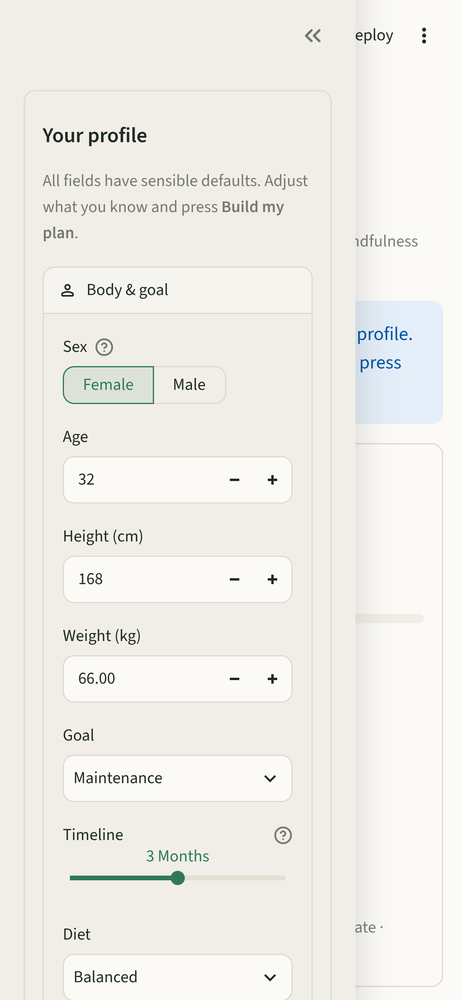
    </td>
  </tr>
</table>

### 📥 Take your plan with you
One click exports a clean Markdown plan. This is the real output for the profile in the screenshots above:

<details>
<summary><b>View the sample <code>wellness-plan.md</code></b></summary>

```markdown
# My Wellness Plan
_Generated 04 November 2026_

**Wellness score:** 62/100 (Fair)
**Goal:** Weight Loss over 3 months

## Nutrition
- Calories: 2,070 kcal/day
- Protein 151 g · Carbs 216 g · Fats 70 g
- Meal pattern: Regular Meals, Early Dinner
- Water: 3.3 L/day

## Movement
- Workout plan: Cardio + Strength
- Exercise: 40 min/day
- Steps: 9,900/day

## Sleep & mind
- Sleep: 7.75 h a night, in bed by 23:00 to wake at 07:00
- Mindfulness: Box Breathing

## Focus areas
- Stress: High stress
- Body weight (BMI): BMI 29.0 (18.5-24.9 is the reference range)
- Sleep quality: Average sleep quality

## Tips
- Add about 1.5 L of water a day. Keeping a bottle in sight makes this easier.
- Move bedtime earlier in 15-minute steps rather than all at once.
- Keep screens out of the last 30-60 minutes before bed and keep the bedroom cool and dark.
- Add ~3,400 steps: a 10-minute walk after meals adds about 1,000 each time.
- Schedule two short breaks a day for your mindfulness practice. Consistency matters more than length.
```

</details>

---

## 🧩 What you get

| Area | Recommendations |
|---|---|
| **Nutrition** | Daily calories · protein / carbs / fats (keto-aware) · meal pattern · water target |
| **Movement** | Workout plan (5 types) · exercise minutes per day · daily step goal |
| **Sleep** | Sleep target by age, training load and stress · personalised bedtime |
| **Mind** | Mindfulness practice (5 types) matched to stress, sleep and mood |
| **Insight** | Wellness score (0-100) · 10-area breakdown · focus areas · strengths · population percentile |
| **Safety** | Blood pressure, resting heart rate, low BMI and age/BMI exercise-clearance notes |

**Inputs:** sex, age, height, weight, goal, timeline, diet, activity level, exercise type and minutes, steps, sleep hours and quality, wake time, stress, mood, focus, water intake, resting heart rate and blood pressure. Every field has a sensible default, so a useful plan takes seconds.

---

## ⚙️ How it works

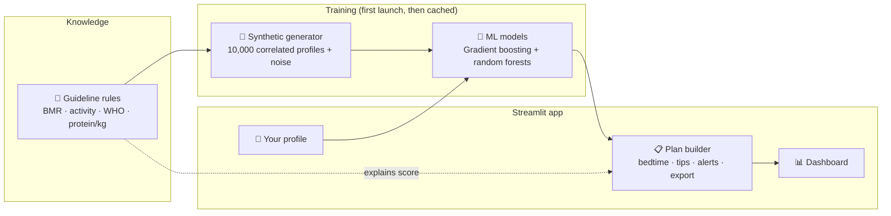

1. **Rules** ([`rules.py`](app/wellness/rules.py)) encode simplified, evidence-informed guidance:
   - Mifflin-St Jeor BMR × activity factor, then a goal-based deficit or surplus scaled to your timeline, with safe calorie floors
   - Protein at 1.2-2.2 g/kg depending on goal, training and diet, with a capped reference weight for high BMI
   - WHO guidance on physical activity (150-300 min/week) and adult sleep (7-9 h)
   - About 33 ml of water per kg of body weight, plus exercise losses
2. **Data** ([`data.py`](app/wellness/data.py)) simulates realistic profiles with modelled correlations: higher BMI goes with less activity, stress with shorter and poorer sleep, and age and BMI with higher blood pressure. Targets come from the rules plus individual variation and label noise, so the models have to *learn* rather than memorise.
3. **Models** ([`model.py`](app/wellness/model.py)) use scikit-learn pipelines:
   - `ColumnTransformer` with `StandardScaler` and `OneHotEncoder`
   - `HistGradientBoostingRegressor` (via `MultiOutputRegressor`) for the 9 numeric targets
   - `RandomForestClassifier` for workout plan, meal pattern and mindfulness practice
   - Permutation importance for explainability
   - Saved with `joblib` and rebuilt automatically when the data or scikit-learn version changes
4. **Recommendations** ([`recommend.py`](app/wellness/recommend.py)) turn predictions into a plan with bedtime, focus areas, tips, alerts and a Markdown export.

### 📊 Model performance (20% held-out test set)

| Numeric target | R² | | Recommendation | Accuracy | Baseline* |
|---|:-:|---|---|:-:|:-:|
| Calories | **0.96** | | Workout plan | **94%** | 32% |
| Protein | **0.94** | | Meal pattern | **94%** | 32% |
| Carbs | **0.98** | | Mindfulness practice | **92%** | 46% |
| Fats | **0.98** | | | | |
| Water target | **0.92** | | | | |
| Exercise target | **0.96** | | | | |
| Steps target | **0.97** | | | | |
| Wellness score | **0.96** | | | | |
| Sleep target | 0.69 | | | | |

<sub>* Baseline = always predicting the most common class.</sub>

> **For context:** the original version of this project produced calorie and macro predictions with R² ≈ −0.01 (no better than the average) and classifiers at baseline accuracy, because its targets were random. Rebuilding the data around real guidelines is what made the ML meaningful.

---

## 🚀 Quick start

Requires **Python 3.11+**.

```bash
git clone https://github.com/GouravLuinor/PersonalWellnessRecommender.git
cd PersonalWellnessRecommender

python3 -m venv .venv
source .venv/bin/activate          # Windows: .venv\Scripts\Activate.ps1

pip install -r requirements.txt
streamlit run app/streamlit_app.py
```

Open **<http://localhost:8501>**. The first launch generates the dataset and trains the models (about 20-30 s). Every launch after that loads them instantly from `data/generated/`.

> 💡 **Zero setup:** open the repo in **GitHub Codespaces** or a **VS Code Dev Container** and the app starts automatically.

### Use the engine from Python

The core package has no Streamlit dependency, so you can use it in notebooks, scripts or an API:

```python
from wellness import data, model, recommend

bundle = model.load_or_train(data.load_or_create_dataset())
profile = recommend.build_profile(**{
    "Sex": "Male", "Age": 41, "Height (cm)": 178, "Weight (kg)": 92,
    "Objective": "Weight Loss", "Timeline": "3 Months", "Diet Type": "Balanced",
    "Activity Level": "Lightly Active", "Workout Type": "Cardio", "Exercise (min/day)": 25,
    "Daily Steps": 6500, "Sleep Duration (hrs)": 6.75, "Sleep Quality": "Average",
    "Wake Up Time (min)": 420, "Stress Level": "High", "Mood": "Neutral",
    "Mental Focus": "Medium", "Water Intake (L)": 1.8, "Resting Heart Rate": 76,
    "Systolic BP": 128, "Diastolic BP": 84,
})
plan = recommend.build_plan(bundle, profile)
print(plan.score, plan.category, plan.bedtime)   # 61.9 Fair 23:00
print(recommend.plan_to_markdown(plan))
```

<sub>Run with the `app/` folder on the import path, e.g. `PYTHONPATH=app python my_script.py`.</sub>

---

## 🧪 Quality

```bash
pip install -r requirements-dev.txt
pytest                 # 47 tests, ~1 minute
ruff check app tests   # lint
```

The suite covers:
- **Rules:** the BMR formula, goal and timeline effects, safe calorie floors, macros summing to calories, keto, target ramps, workout-plan logic, and score bounds
- **Data:** schema, determinism by seed, valid categories, plausible ranges, modelled correlations, cache recovery
- **Models:** every target beats its naive baseline, predictions respond to inputs and are deterministic, cache invalidation
- **Plans:** BMI derivation, bedtime across midnight, blood-pressure alert thresholds, tips, export
- **App:** end-to-end Streamlit `AppTest` runs of the sample plan, a personalised submission and switching comparison metrics

GitHub Actions runs lint and tests on Python 3.11 and 3.12 for every push and pull request.

---

## 🗂️ Project structure

```text
PersonalWellnessRecommender/
├── app/
│   ├── streamlit_app.py        # Streamlit dashboard
│   └── wellness/               # Core engine (no UI dependency)
│       ├── schema.py           # Feature/target definitions and options
│       ├── rules.py            # Guideline-based targets and wellness score
│       ├── data.py             # Synthetic dataset generation and caching
│       ├── model.py            # Training, evaluation, persistence, inference
│       └── recommend.py        # Plan building, tips, alerts, Markdown export
├── tests/                      # 47 pytest tests
├── .streamlit/config.toml      # Light and dark theme
├── .github/workflows/ci.yml    # Lint and test on push / PR
├── .devcontainer/              # Codespaces / Dev Container setup
├── data/generated/             # Runtime dataset and models (git-ignored)
├── docs/                       # Report, methodology, screenshots, legacy docs
├── notebooks/                  # Original exploratory notebook
├── requirements.txt            # Runtime dependencies
├── requirements-dev.txt        # + pytest, ruff, notebook libraries
└── pyproject.toml              # pytest and ruff configuration
```

## 🛠️ Tech stack

| Layer | Tools |
|---|---|
| Language | Python 3.11+ |
| ML | scikit-learn (HistGradientBoosting, RandomForest, pipelines, permutation importance) |
| Data | pandas, NumPy |
| UI | Streamlit, Altair |
| Persistence | joblib |
| Quality | pytest, Streamlit AppTest, Ruff, GitHub Actions |
| Dev environment | VS Code Dev Containers / GitHub Codespaces |

---

## 🗺️ Roadmap

- [ ] Validate against suitable real-world public datasets
- [ ] Per-prediction explanations (SHAP)
- [ ] Optional saved profiles to track progress over time
- [ ] REST API for inference, separate from the UI
- [ ] Metric / imperial unit toggle

## ⚠️ Limitations

- The dataset is **synthetic**. The models learn this project's own rules, so high accuracy shows the pipeline works, **not** that the advice is clinically validated.
- The rules are simplified population-level guidance and don't account for medical conditions, medications, pregnancy or other individual factors.
- The wellness score is a heuristic, not a validated clinical index.
- The notebook in `notebooks/` documents the original (v1) approach and its older data generator.

## 📚 Documentation

- [`docs/project-report.pdf`](docs/project-report.pdf): project report
- [`docs/synthetic-data-methodology.pdf`](docs/synthetic-data-methodology.pdf): original synthetic-data methodology
- [`docs/legacy/`](docs/legacy/): documentation from the original repositories before consolidation

---

<div align="center">

**Disclaimer:** this is an educational machine learning project. It does not provide medical advice, diagnosis or treatment.<br>
Always consult a qualified healthcare professional about decisions concerning your health.

Built by [GouravLuinor](https://github.com/GouravLuinor)

</div>
